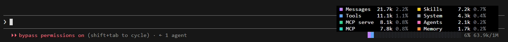

# Claude Code context window bar

A Claude Code plugin (`context-pane`) that keeps the context window in view. A bar at the right end of the prompt footer, next to the permission mode, shows how full the window is. The used part is split into colours by category: messages, system tools, MCP, memory, skills, agents, system prompt. Hover the bar and you get the breakdown in tokens and percent.



- The fill is the live figure, the same one the status line uses. The `Messages` row includes tool results, which the built-in breakdown leaves out ([#94436](https://github.com/anthropics/claude-code/issues/94436)).
- Each category always gets the same colour.
- `/context-pane` opens the same breakdown as a side pane.
- The breakdown is a local estimate. It makes no extra API calls and refreshes after every turn.

In fullscreen mode (`"tui": "fullscreen"`) the breakdown floats over the transcript.

## Known limitation

Without fullscreen mode the breakdown should open in the band above the prompt, but Claude Code does not draw it there yet, and the debug log shows no error. The footer bar works in both modes.

## Install

At the prompt of a terminal session:

```
/plugin install context-pane --marketplace koprjaa/claude-code-context-bar
```

Answer `y` to add the marketplace, then pick a scope.

From a shell:

```
claude plugin install context-pane --marketplace koprjaa/claude-code-context-bar
```

In the desktop app, where `/plugin` does not run: click + next to the prompt box, then Plugins, Add marketplace with `koprjaa/claude-code-context-bar`, then Add plugin.

## Develop

```
claude plugin validate .
claude plugin test .
```
